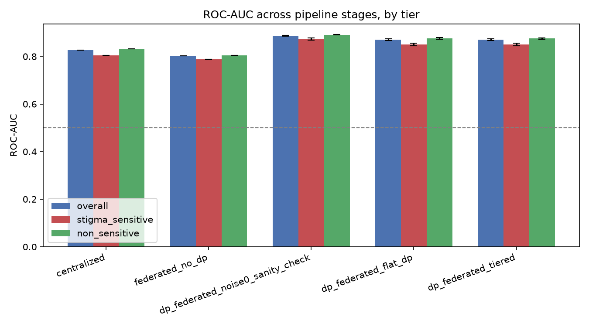
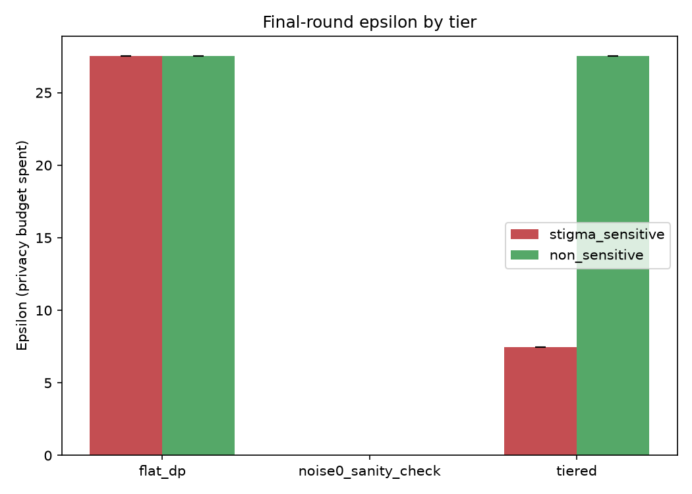
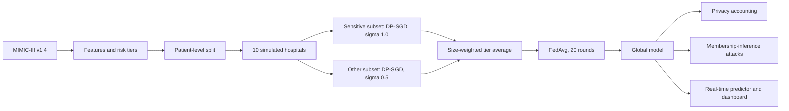

# Risk-Aware Privacy Preservation for Real-Time Health Analytics in EHR Systems

Federated mortality prediction on MIMIC-III where **stigma-sensitive patients get stronger differential privacy than everyone else**. Each hospital trains its sensitive and non-sensitive patients in separate DP-SGD passes with different noise levels, and the trained model is served in real time.


Course project for CSE4068 at VIT Chennai. Research prototype, not for clinical use.

## Why this exists

Hospitals cannot pool patient records, so federated learning keeps data local. But model updates can still leak whether a particular patient was in the training set. Differential privacy (DP) bounds that leak at a cost in accuracy, and a single noise level for everyone either over-protects routine records or under-protects sensitive ones.

This project asks: what does it cost, and what does it buy, to give diagnoses that carry social stigma a tighter privacy budget than routine admissions?

## Key results

Full MIMIC-III v1.4: 46,519 patients, 58,961 admissions, 10 simulated hospitals, 20 federated rounds, 5 training seeds.

| Configuration | Noise (sensitive / other) | Sensitive-tier ε per round | Overall ROC-AUC |
|---|---|---|---|
| Centralized, no DP | none | none | 0.826 |
| Federated, no DP | none | none | 0.802 |
| Federated, clipping only (σ = 0) | 0 / 0 | none | 0.887 |
| Flat DP | 0.5 / 0.5 | 27.5 | about 0.870 |
| **Tiered DP** | **1.0 / 0.5** | **7.5** | **about 0.870** |

- **Tighter guarantee, same accuracy.** Tiering gives sensitive patients a 3.7x tighter per-round ε (27.5 to 7.5, down to 2.5 at σ = 2.0). Sensitive-tier ROC-AUC stays near 0.851 and does not differ from flat DP (paired t-test p = 0.76).
- **Epsilon is per round.** Cumulative ε over 20 rounds (Opacus PRV accountant) is about 38 to 43 for tiered sensitive patients versus 167 to 181 for flat DP. The relative gain holds; the absolute guarantees are weak. See `src/privacy/accounting.py`.
- **Attacks.** On the main pipeline a loss-threshold membership-inference attack scores about 0.50 for every configuration, because the model generalizes. A deliberately memorizing model scores 0.77, so the attack does detect leakage when it exists. In an attack stress test (small subsets, wide network) the non-private model overfits (train-test AUC gap 0.050) and a reference-model attack reaches 0.516 balanced accuracy; DP removes the gap and returns the attack to about 0.508. Flat and tiered DP are indistinguishable on every attack: the evidence for tiering is the tighter formal bound, not lower empirical leakage.
- **Real time.** Scoring one admission takes about 0.08 ms at the median and 0.19 ms at p99 on a laptop CPU, against a 100 ms budget.

The no-DP baselines use fewer optimization steps than the DP runs, so cross-method utility gaps are not step-matched.




## How it works



- **Model:** a small MLP (14 inputs: age, gender and 12 vital signs; hidden layers 32 and 16).
- **DP:** Opacus DP-SGD with per-sample clipping at 1.0, δ = 1e-5, Poisson sampling.
- **Tiers:** each admission is labeled stigma-sensitive or non-sensitive from its diagnoses (`src/data/tier_mapping.py`). The sensitive-diagnosis list is judgment-based.
- **Split:** by patient, stratified by tier and outcome, so no patient appears in both train and test.

## Repository layout

```
App.py                      Streamlit dashboard (8 tabs, reads results/ and models/ only)
requirements.txt
data/                       Put MIMIC-III here (git-ignored, see data/README.md)
scripts/                    Data audits and checks
src/
  data/                     Dataset build, tier mapping, client partitioning, split
  models/                   Baselines, federated, DP federated, noise ablation
  privacy/                  Tiered DP config, epsilon accounting, membership inference,
                            validity check, attack stress test
  realtime/                 Model export, single-admission predictor, stream replay
  plot_noise_ablation.py
  visualize.py              Figures and summary tables
models/                     Exported models for the real-time tab
results/                    metrics/ (CSVs) and figures/
```

## Getting started

```
git clone https://github.com/<your-username>/healthcare-fl-dp.git
cd healthcare-fl-dp
python -m venv venv
venv\Scripts\activate          # Linux/macOS: source venv/bin/activate
pip install -r requirements.txt
```

### Explore the results (no MIMIC access needed)

```
streamlit run App.py
```

The dashboard reads the precomputed aggregates in `results/` and the exported models in `models/`. It never touches patient data.

### Reproduce everything (needs MIMIC-III)

MIMIC-III is access-controlled. Complete CITI training, sign the PhysioNet data use agreement, and download v1.4 from <https://physionet.org/content/mimiciii/1.4/>. Place the files as described in [`data/README.md`](data/README.md). The data is never committed to this repository.

```
python -m scripts.extract                 # unzip the .csv.gz files
python -m src.data.dataset                # builds data/processed/modeling_table.csv
python -m src.models.baseline             # centralized baseline
python -m src.models.federated            # FedAvg without DP
python -m src.models.dp_federated         # noise0 / flat / tiered, 5 seeds, MIA, significance tests
python -m src.privacy.mia_validity_check
python -m src.models.noise_ablation       # sensitive-tier noise sweep
python -m src.plot_noise_ablation
python -m src.visualize                   # figures and summary tables
python -m src.privacy.leaky_regime        # attack stress test (about 17 min per seed on a laptop CPU)
python -m src.realtime.export_model --config tiered
python -m src.realtime.stream_sim --name tiered --n 2000
streamlit run App.py
```

Add `--quick` to `leaky_regime` for a smoke test, and `python -W ignore` to hide harmless Opacus warnings. Data audits live in `scripts/` (for example `python -m scripts.audit_icd_coverage`).

### Real-time scoring example

In the dashboard's Real-time scoring tab, or in Python:

```python
from src.realtime.predictor import RiskPredictor

predictor = RiskPredictor(name="tiered")
result = predictor.predict(predictor.default_record())
print(result["risk"], result["band"], result["latency_ms"])
```

Risk bands (low below 10%, moderate 10 to 30%, high 30% and above) are illustrative, not clinically calibrated.

## Limitations

- One dataset (a single institution) and one model family; hospitals are simulated on one machine by stratified splitting, with no secure aggregation or network deployment.
- The five seeds share one fixed patient split, so p-values reflect training randomness only.
- Only membership inference was evaluated. Attribute inference and reconstruction attacks were not.
- ε is per round in the main pipeline; cumulative ε is roughly 5 to 6 times larger.
- Opacus runs with its secure RNG off, which is fine for experiments but not for deployment.

## Data and ethics

No MIMIC-III data, derived patient-level tables or credentials are included in this repository, in line with the PhysioNet data use agreement. Only aggregate results and two tiny exported models are. If you reproduce this work, you must obtain your own credentialed access.

## Citation and acknowledgements

- Johnson, A. E. W., Pollard, T. J., Shen, L., et al. *MIMIC-III, a freely accessible critical care database.* Scientific Data 3, 160035 (2016). <https://doi.org/10.1038/sdata.2016.35>
- Goldberger, A. L., et al. *PhysioBank, PhysioToolkit, and PhysioNet.* Circulation 101(23), e215-e220 (2000).
- Built with [Opacus](https://opacus.ai/), [PyTorch](https://pytorch.org/) and [Streamlit](https://streamlit.io/).

## Author

Arunkumaran A, VIT Chennai (CSE4068).

## License

MIT. See [`LICENSE`](LICENSE).
